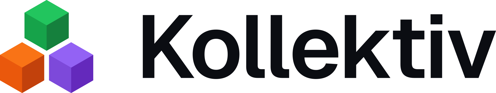
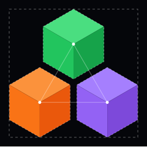
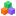
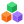

# Kollektiv mark

The Kollektiv mark is three isometric blocks stacked as one, each in one
product's colour: Konnekt green on top, Kommands ember below left, Kube violet
below right. Each block is drawn the way Konnekt's is, so the suite's mark and
the products' share one construction, and the suite carries every product's
colour while each product mark keeps only its own.

<picture>
  <source media="(prefers-color-scheme: dark)" srcset="lockup-on-dark.svg">
  
</picture>

The directions it was chosen from, and the references behind them, are in the
study at https://claude.ai/artifact/GccCUv5yydu2buzQYMZSEE (private to the
project).

## Files

Every file is an SVG on a transparent background, except the app icons. The
gaps between blocks, and between faces in the one-colour files, are left
undrawn, so they are real transparency on any ground.

| File | Use |
| --- | --- |
| [`mark-on-dark.svg`](mark-on-dark.svg), [`mark-on-light.svg`](mark-on-light.svg) | The mark, at 17 px and above |
| [`mark-16-on-dark.svg`](mark-16-on-dark.svg), [`mark-16-on-light.svg`](mark-16-on-light.svg) | 16 px and below, drawn on a 16 grid |
| [`mark-mono-white.svg`](mark-mono-white.svg), [`mark-mono-black.svg`](mark-mono-black.svg) | One colour: the faces are separated by gaps instead of shade |
| [`lockup-on-dark.svg`](lockup-on-dark.svg), [`lockup-on-light.svg`](lockup-on-light.svg) | Mark and wordmark, the wordmark outlined |
| [`app-icon.svg`](app-icon.svg) | The mark at 80 % on a full-bleed `#05060a` square |
| [`app-icon-16.svg`](app-icon-16.svg) | The 16 cut on the same square, for 16 px favicons |
| [`construction.svg`](construction.svg) | The construction below |

## Construction

Drawn on a 24-unit grid, like Konnekt's. The mark fills a 21-unit live area,
1.5 units in from every edge, and is centred on its own bounds.

| Part | Rule | Value in `mark-on-*.svg` |
| --- | --- | --- |
| Block | An isometric cube: a regular hexagon of radius *r*, split into three faces at its centre, lit from above | *r* = 5.728 |
| Arrangement | Two blocks side by side, the third on top, centred between them: the blocks' centres form an equilateral triangle | |
| Gap | Constant between every pair of facing edges | 1.1, the same as Konnekt's |
| Base | Each block's faces sit on a hexagon filled with its left face's shade, so the seams between faces anti-alias against the block's own colour, not the ground, and draw no dark line | |
| Bounds | Set by the live area's height | 20.94 × 21 |

## Sizes

The full mark holds down to 17 px: at 24 px the gaps are 1.1 px, and at 17 px
still 0.8. Unlike Konnekt's there is no 24 cut, because there is no thin stroke
to thicken.

At 16 px and below it is redrawn on its own 16 grid. The blocks touch, with no
gap, because a gap there falls under a pixel; the three hues keep them apart.
Every vertical edge sits on a whole or half pixel (x = 1, 4.5, 8, 11.5, 15), and
the mark's outermost edges and its middle on whole ones, so it stays sharp in a tab.

Sizes are device pixels, as in Konnekt's README: a mark laid out at 16 px on a
2× screen takes the full drawing.

    

## Colour

Each block takes three shades of its product's colour: the lightest on top,
the darkest on the right. On light grounds every face steps one shade darker,
as Konnekt's do.

| Block | On dark: top, left, right | On light: top, left, right | Where the colour comes from |
| --- | --- | --- | --- |
| Konnekt | `#4ade80` `#22c55e` `#16a34a` | `#22c55e` `#16a34a` `#15803d` | `accent` and `success` in `tokens.json`; `#15803d` is Konnekt's light-ground shade, not a token yet |
| Kommands | `#fb923c` `#f97316` `#ea580c` | `#f97316` `#ea580c` `#c2410c` | `PRODUCT_ACCENT` in Kommands' `src/lib/theme.ts` (Tailwind's orange 400), then orange 500 to 700, as the green ladder is Tailwind's green 400 to 700 |
| Kube | `#a57ffe` `#9362f4` `#7d49da` | `#9362f4` `#7d49da` `#6429bc` | Chosen here, see below |

Kommands' and Kube's colours are each product's own and are not in
`tokens.json`, the same choice the Kollektiv site's tiles make for Kommands'
ember. They live in these files and in each product.

**Kube's violet.** In OKLCH it is hue 295, with each face 0.09 darker than the
green and ember ladder (0.69, 0.62, 0.545; 0.455 on light) so that its top face
reaches the green's chroma of 0.18. A lighter violet at the green's lightness
could not: in sRGB, violet that light tops out near chroma 0.12 and reads as
washed out beside the other two. Hue 295 was chosen because it is the furthest
from green, ember and the status colours, and because green and ember are
close for deuteranopes (an OKLab distance of 7, against 26 for typical colour
vision, simulated with Machado, Oliveira and Fernandes 2009), so the third
colour has to be the one that stays apart. It does, in all three simulations.

| Part | On dark | On light |
| --- | --- | --- |
| Wordmark | `#ffffff` | `#0b0d12` |

## Lockup

The same rules as Konnekt's, so the two lockups sit together:

- The mark's box is 1.2 times the wordmark's font size, and its centre sits on
  the middle of the cap height.
- The gap between the box and the wordmark is 0.4 times the font size.
- The wordmark is Geist SemiBold at -0.03 em tracking, outlined from Geist 1.200
  (the npm `geist` package). Geist is © Vercel under the SIL Open Font License 1.1.
- Clear space: at least half the mark's height on every side.
- Minimum sizes: the mark at 16 px with the 16 cut; the lockup at 96 px wide.
  Below that, use the mark alone.

The lockup file is 1.05 times as tall as its font size, because the mark is
taller than the wordmark's caps. To set the wordmark at a given font size, size
the image at 1.05em; the website does.

## Do not

- Reorder the blocks, or give a product a block in another's colour.
- Add a fourth block. The arrangement is built for three; a fourth product means
  redrawing it.
- Scale the 16 cut up, or the full mark down past 17 px.
- Add outlines, shadows, gradients or glows, or recolour outside the table above.
- Put the coloured mark on a mid-tone ground. Use the app icon tile, or a mono file.

## Where it is used

- **Website.** The favicons are `app-icon-16.svg` rendered at 16 px and
  `app-icon.svg` at 32 and 256 px, in `website/assets/img/`. The bar and the
  footer show `lockup-on-dark.svg`, copied there as `lockup.svg`. Re-copy and
  re-render them when this folder changes.
- **The products.** Nothing yet. Konnekt keeps its own mark in its
  `docs/brand/`.
